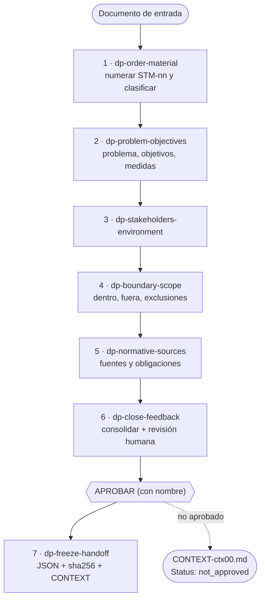
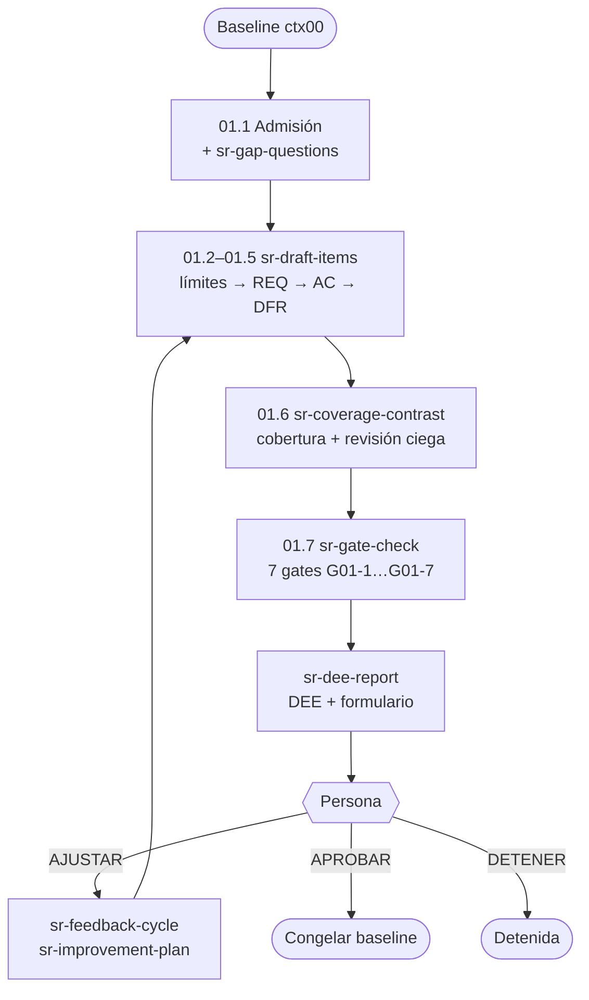
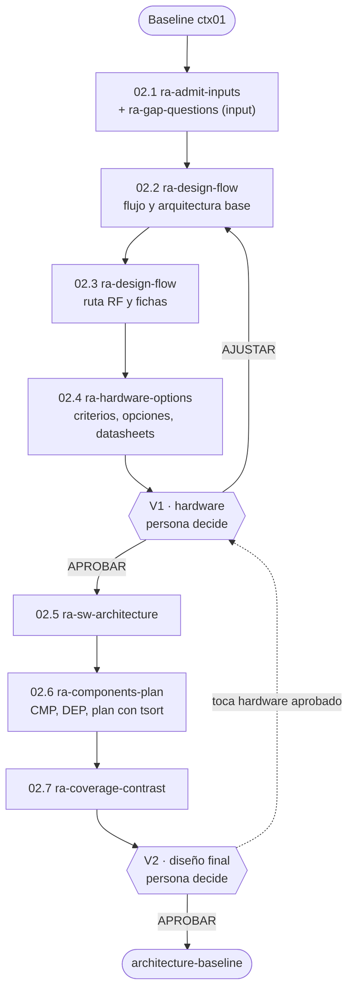
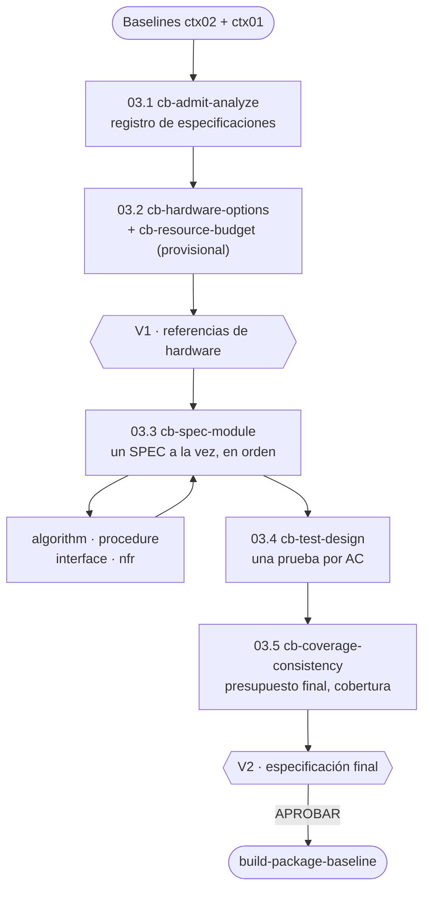

# Proceso para generar el Build Package — flujo y filosofía

> **Para qué sirve este documento.** Explicar el proceso completo que lleva de un documento de entrada al *Build Package*, con su filosofía, el flujo general y el flujo de cada etapa. Es una explicación para entender y revisar la metodología; **no** es la fuente operativa.
>
> **Fuente operativa.** Lo que el agente ejecuta está en `AGENTS.md` (punto de entrada), `pipeline-layout/SKILL.md` (rutas y hashes) y el `SKILL.md` de cada etapa. Si este documento discrepa de ellos, mandan ellos.
>
> **Para usar la metodología** (cómo correrla, dónde quedan los resultados, cómo responder en cada validación) ver [`GUIA-DE-USO.md`](../GUIA-DE-USO.md).
>
> **Versión:** 4.0 · 11 de noviembre de 2026.
>
> **Qué cambia respecto de la versión 3.0.** La 3.0 describía un motor de código con un Documento de Entrega de Etapa común, una skill `adjust-stage` y registros de tokens y tiempo. El diseño vigente es otro: **el agente ejecuta cada etapa siguiendo skills** (`dp-*`, `sr-*`, `ra-*`, `cb-*`), las comprobaciones mecánicas se hacen con comandos de shell (`sha256sum`, `jq`, `grep`, `tsort`) y **no se escribe ni se conserva ningún script**. Los resultados viven en `results/ctxNN/`. La validación humana es distinta en cada etapa (ver §5). Ya no existen `adjust-stage`, los registros de tokens ni el motor de reglas compartido.

---

## 1. El resultado que buscamos

El **Build Package** es el manual de construcción del sistema: una especificación completa, trazable y aprobada por una persona, con la que un desarrollador implementa sin tener que decidir nada de diseño.

> Cada requisito llega al final convertido en una prueba que lo comprueba; cada decisión de diseño llega escrita, con su porqué; y no queda ni un número ni un procedimiento a criterio de quien construye.

Producto final: `results/ctx03/build-package-baseline.json` (más `.sha256` y `.md`) y `results/ctx03/final-spec.md`.

---

## 2. Filosofía

1. **La persona decide.** El agente extrae, redacta, comprueba y pregunta. Alcance, prioridades, hardware y toda aprobación (`APROBAR`, `AJUSTAR`, `DETENER`, `CERRAR_FORZADO`) son decisión humana. Un modelo nunca aprueba su propia salida y el silencio nunca es aprobación.
2. **No se inventa.** Un valor es `declarado` solo si está literalmente en una cita de la fuente, en una hoja de datos o en una respuesta humana. Si no, es `derivado` (con la operación escrita) o `propuesto` (visible). Donde el material no alcanza, se hace una pregunta.
3. **Lo mecánico se comprueba, no se opina.** Hashes, citas, cobertura, orden de dependencias y unidades se verifican con comandos de shell. Lo que requiere juicio se declara como tal y se revisa con un contexto independiente (subagente) o, si no es posible, se registra como menos fiable.
4. **Lo anterior es de solo lectura.** Cada etapa escribe únicamente en su carpeta `results/ctxNN/`. Un cambio que afecte una etapa ya congelada no es una edición: es una **escalación** (R0 alcance, R1 requisitos, R2 diseño) que decide la persona.
5. **Nada se pierde en silencio.** Todo elemento recibido tiene una disposición registrada (adoptado, descartado con código, aplazado, escalado). Los requisitos sembrados nunca se borran.
6. **Producto mínimo viable.** Todo componente o elemento cita el requisito que lo justifica; lo «deseable» va a `beyond-MVP`.
7. **Cadena de hashes.** Cada etapa congela una *baseline* JSON con su `.sha256`; la siguiente se niega a empezar si el hash no verifica.
8. **Contexto aislado por etapa.** Cada etapa se corre en una sesión nueva o con el contexto limpio. Lo único que viaja entre etapas son los archivos de `results/`, y cada etapa termina con una nota `CONTEXT-ctxNN.md` que la siguiente lee primero.
9. **Artefactos en inglés**, conversación en el idioma de la persona.

---

## 3. El flujo general

```mermaid
flowchart LR
    IN(["inputs/<br/>documento de entrada"]) --> E0["<b>ctx00</b><br/>Definir el problema<br/>define-problem"]
    E0 --> H0{{"Validación humana<br/>APROBAR"}}
    H0 --> E1["<b>ctx01</b><br/>Especificar requisitos<br/>specify-requirements"]
    E1 --> H1{{"Gate 1<br/>APROBAR / AJUSTAR / DETENER"}}
    H1 --> E2["<b>ctx02</b><br/>Resolver arquitectura<br/>resolve-architecture-v2"]
    E2 --> H2{{"V1 hardware<br/>V2 diseño final"}}
    H2 --> E3["<b>ctx03</b><br/>Compilar el Build Package<br/>compile-build-package-v2"]
    E3 --> H3{{"V1 referencias hardware<br/>V2 especificación final"}}
    H3 --> BP(["<b>Build Package</b>"])
    E3 -. "R2 / R1 / R0" .-> E2
    E2 -. "R1 / R0" .-> E1
    E1 -. "R0" .-> E0
```



| Etapa | Entrada | Pregunta que responde | Salida congelada | Paradas humanas |
|---|---|---|---|---|
| **ctx00** | documento en `inputs/` | ¿Qué problema, para quién, hasta dónde? | `problem-baseline.json` + `problem-definition.md` | 1 revisión final (hasta 3 rondas) |
| **ctx01** | baseline ctx00 | ¿Qué debe hacer, con qué límites, cómo se comprueba? | `requirements-baseline.json` (REQ, LIM, AC, DFR) | DEE por ronda (hasta 6 salidas) |
| **ctx02** | baseline ctx01 | ¿Cómo se resuelve y con qué hardware de referencia? | `architecture-baseline.json` + `final-design.md` | V1 (hardware) y V2 (diseño final) |
| **ctx03** | baselines ctx02 y ctx01 | ¿Qué recibe el desarrollador para no decidir nada? | `build-package-baseline.json` + `final-spec.md` | V1 (referencias de hardware) y V2 (especificación) |

**Estructura de cada etapa.** Todas tienen un `SKILL.md` que es su **único punto de entrada** y que orquesta; un conjunto de sub-skills con prefijo propio que se cargan **una a una** (`dp-`, `sr-`, `ra-`, `cb-`); una carpeta `references/` con esquemas, plantillas y registros; y, en ctx01–ctx03, una carpeta `evals/` que **ningún skill lee**.

**Estructura del repositorio y resultados:**

```
AGENTS.md  GUIA-DE-USO.md
inputs/                 documento(s) de entrada
pipeline-layout/        rutas, reglas de hash, guardrails.md
define-problem/  specify-requirements/  resolve-architecture-v2/  compile-build-package-v2/
results/ctx00 … ctx03/  todo lo que produce la metodología
```

**Mecanismos comunes (ctx01–ctx03):**

- **Admisión mecánica:** antes de empezar, `sha256sum -c` de la baseline anterior y comprobaciones con `jq`. Si falla, la etapa no arranca: un desajuste de versión se repite contra la baseline vigente; un defecto de contenido es un retorno R0/R1.
- **Preguntas abiertas:** el agente solo pregunta lo que pasa tres pruebas anti-sesgo, con tope de 8 preguntas nuevas por corrida. Cada pregunta se responde con contenido o con `CERRAR_FORZADO`.
- **Gates:** tablas de evidencia (cada compuerta con su ID, qué se comprobó y el resultado). Un `FAIL` no impide mostrar el documento, pero **bloquea `APROBAR`**. Nunca se relaja una regla para que pase.
- **Revisión ciega:** cobertura en ambos sentidos más una revisión por un subagente que no ve el borrador.
- **Trazabilidad:** `state.json` y `events.jsonl` registran el estado, de modo que una sesión nueva pueda reanudar.

---

## 4. Flujo de cada etapa

### 4.1 ctx00 · Definir el problema (`define-problem`)

**Objetivo.** Ponerse de acuerdo en el problema estable antes de hablar de requisitos o soluciones. No se nombra ninguna solución: si el material la trae, se aparta como `SOL-nn`.



- **Verificaciones transversales:** `dp-verify-citations` (cita literal contra el material o la copia local de la fuente), `dp-verify-consistency` (clasificación, magnitudes, contradicciones) y `dp-gap-search` (búsqueda de huecos).
- **Validación humana: una sola, al final.** No hay revisión entre subetapas; las preguntas abiertas se acumulan y se presentan juntas en el documento.
- **Rondas:** hasta 3 de retroalimentación; la búsqueda de huecos se repite como máximo 2 veces (tras las rondas 1 y 2).
- **Aprobación:** solo con el `APROBAR` literal de la persona y su nombre, y con cero preguntas abiertas. Si tras la ronda 3 no está limpio, la etapa queda **no aprobada** y se reinicia con una entrada corregida.
- **Salida:** `results/ctx00/` con `intake.md` (inmutable), `sources/`, `problem-definition.md` (11 secciones), `problem-baseline.json`, `problem-baseline.sha256`, `CONTEXT-ctx00.md`.

### 4.2 ctx01 · Especificar requisitos (`specify-requirements`)

**Objetivo.** Convertir el problema congelado en requisitos y criterios de aceptación medibles. Solo se dice **qué**, nunca **cómo**: sin algoritmos, arquitectura ni contratos de componentes.



- **Elementos:** `REQ` (requisitos), `LIM` (límites con valor, unidad, sentido y fuente), `AC` (criterios de aceptación), `DFR` (aplazamientos controlados) y requisitos **sembrados** desde `pipeline-layout/guardrails.md`.
- **Reglas clave:** todo lo transferido de ctx00 termina adoptado o descartado con código; todo objetivo y todo elemento del alcance tiene al menos un requisito o una exclusión aprobada; un valor que no esté en la cita literal nunca es `declarado`.
- **Validación humana:** el agente emite un **DEE** (documento de seis secciones: resumen, contenido, lo que decidió el agente, lo que queda abierto, resultado de los gates y decisión pendiente) y un formulario de respuesta. La persona responde con `APROBAR`, `AJUSTAR` o `DETENER`.
- **Rondas:** hasta **6 salidas** (O1–O6). Preguntas nuevas solo en O1 y O2; en O3 se **fuerzan a cerrar** las que sigan abiertas; de O4 en adelante solo temas de mejora. Tras O6 solo cabe `APROBAR` o `DETENER`.
- **Aprobación:** gates limpios y firma humana. Con algún `DFR` abierto, la única aprobación posible es `APROBAR_CON_APLAZAMIENTO`.
- **Salida:** `results/ctx01/` con `record.json`, `state.json`, `events.jsonl`, `rounds/O<n>/`, `requirements-baseline.json/.sha256/.md`, `CONTEXT-ctx01.md`.

### 4.3 ctx02 · Resolver la arquitectura (`resolve-architecture-v2`)

**Objetivo.** Diseñar la arquitectura y elegir **referencias de hardware** (solo el SDR y la placa de cómputo); todo lo demás recibe una ficha de características. No se especifican procedimientos ni parámetros (eso es ctx03) ni se inventan requisitos (eso es ctx01).



- **Fase A (hasta V1):** flujo, arquitectura mínima, ruta RF y comparación de hardware. Los **criterios se escriben y guardan antes de comparar** alternativas; la comparación aplica un filtro eliminatorio con evidencia por celda, un orden ordinal y una prueba de robustez.
- **V1 (hardware):** se aprueba el hardware, y los ítems aprobados quedan **bloqueados** (`locked_v1`).
- **Fase B (hasta V2):** arquitectura de software, componentes (`CMP`), dependencias (`DEP`) y plan (debe coincidir con el orden de `tsort`).
- **Gates:** G02-1 a G02-8 (integridad de entrada, criterios previos, filtro eliminatorio, alcance/MVP, frontera con ctx03, preguntas, cobertura bidireccional y cierre de DFR, grafo acíclico).
- **Rondas por validación:** R1 y R2 admiten preguntas nuevas; R3 solo respuestas y temas; **R4 solo `APROBAR` o `DETENER`**. Hasta 3 ajustes por validación (V1 y V2 por separado).
- **Escalaciones:** `escalate:V1` (un cambio en V2 toca hardware ya aprobado; consume una ronda de V1), `escalate:R1` o `escalate:R0` (estado `returned_upstream`).
- **Salida:** `results/ctx02/` con `state.json`, `events.jsonl`, `questions.json`, `items.json`, `substages/`, `validations/V1|V2/R<n>/`, `architecture-baseline.json/.sha256/.md`, `final-design.md`, `CONTEXT-ctx02.md`.

### 4.4 ctx03 · Compilar el Build Package (`compile-build-package-v2`)

**Objetivo.** Especificar cómo se cumple cada requisito en la práctica, sin cambiar la arquitectura ni los requisitos. Cierra lo que ctx02 dejó abierto (`TBD-Ctx03`, aplazamientos, puntos sin verificar como la temperatura máxima de la placa o su carga de cómputo).



- **Disciplina del bucle (03.3):** un módulo se termina, se autocomprueba y se registra antes de empezar el siguiente; el orden del registro es el único orden; nunca se omite un módulo. Si falta un valor que solo una persona puede dar, el módulo se completa con un valor `provisional` y una pregunta candidata.
- **Paquete autosuficiente:** los valores y el texto de los requisitos se copian, no se referencian; sin código ejecutable, sin resultados de medición, sin `TBD`.
- **Consistencia con el hardware:** todo valor que use cómputo, memoria, almacenamiento, caudal, energía, nivel RF o tiempo se contrasta con una capacidad citada, con margen.
- **Pruebas:** una prueba por criterio de aceptación, con el umbral idéntico al del criterio, tres casos y condición de fallo.
- **Gates:** G03-1 a G03-11 (incluye la **prueba de consumidor**: un implementador ciego que solo lee el paquete no debe necesitar ninguna decisión de diseño).
- **Web:** solo en 03.2, para hojas de datos, y las consultas llevan únicamente nombres de componentes y especificaciones, nunca datos del proyecto.
- **Rondas y escalaciones:** igual que ctx02, con retornos `escalate:V1`, `R2`, `R1`, `R0`.
- **Salida:** `results/ctx03/` con `state.json`, `STATUS.md`, `events.jsonl`, `questions.json`, `items.json`, `spec-register.json`, `specs/SPEC-nn.md`, `validations/`, `build-package-baseline.json/.sha256/.md`, `final-spec.md`, `CONTEXT-ctx03.md`.

---

## 5. Validación humana: resumen comparado

| | ctx00 | ctx01 | ctx02 | ctx03 |
|---|---|---|---|---|
| Número de paradas | 1 | 1 por salida (hasta 6) | 2 (V1, V2) | 2 (V1, V2) |
| Documento que se lee | `problem-definition.md` | `rounds/O<n>/dee.md` | `validations/V<k>/R<n>/hardware-proposal.md` o `final-design.md` | `validations/V<k>/R<n>/hardware-proposal.md` o `final-spec.md` |
| Dónde se responde | en el chat (`APROBAR` + nombre y respuestas a las preguntas) | `rounds/O<n>/response-form.md` | `validations/V<k>/R<n>/feedback.md` | `validations/V<k>/R<n>/feedback.md` |
| Decisiones | `APROBAR` / ajustes / parar | `APROBAR` · `AJUSTAR` · `DETENER` | igual | igual |
| Cierre forzado | pregunta cerrada por la persona como «forzada» | automático en O3 | `CERRAR_FORZADO: <Q-id>` | `CERRAR_FORZADO: <Q-id>` |
| Tope | 3 rondas | 6 salidas | 3 ajustes por validación | 3 ajustes por validación |
| Qué bloquea `APROBAR` | preguntas abiertas | gate en `FAIL` | pregunta abierta de ese gate o gate en `FAIL` | igual |
| Resultado si no se aprueba | `not_approved` | `DETENER` | `stopped` / `blocked` / `returned_upstream` | igual |

**Invariantes de toda validación:** el agente se detiene y espera; la persona aprueba con su decisión explícita; ninguna pregunta se cierra sin respuesta o `CERRAR_FORZADO` (salvo el cierre automático de ctx01 en O3); toda respuesta y todo tema recibe una disposición registrada.

---

## 6. Cómo se protege la calidad

- **Procedencia visible** (`declarado` / `derivado` / `propuesto`) en cada valor y decisión.
- **Citas literales** verificadas contra el material de entrada o la copia local de la fuente.
- **Cobertura en ambos sentidos** (objetivo → requisito → componente → especificación → prueba, y de vuelta).
- **Revisión ciega** por un contexto independiente en ctx01–ctx03.
- **Hashes encadenados**, verificados al admitir cada etapa.
- **Los gates en verde son condición necesaria, no suficiente:** la persona puede responder `AJUSTAR` con todo en verde; mirar el contenido y no quedar convencido ya es un hallazgo.

**Límites conocidos.** Sin subagentes, las revisiones independientes se ejecutan en el mismo contexto y quedan registradas como menos fiables. Si el revisor humano aporta juicio realmente independiente sigue siendo una pregunta abierta de la metodología.
