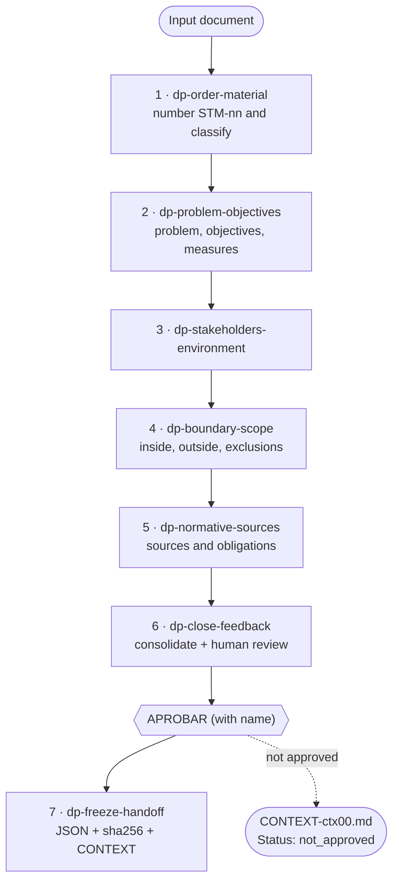
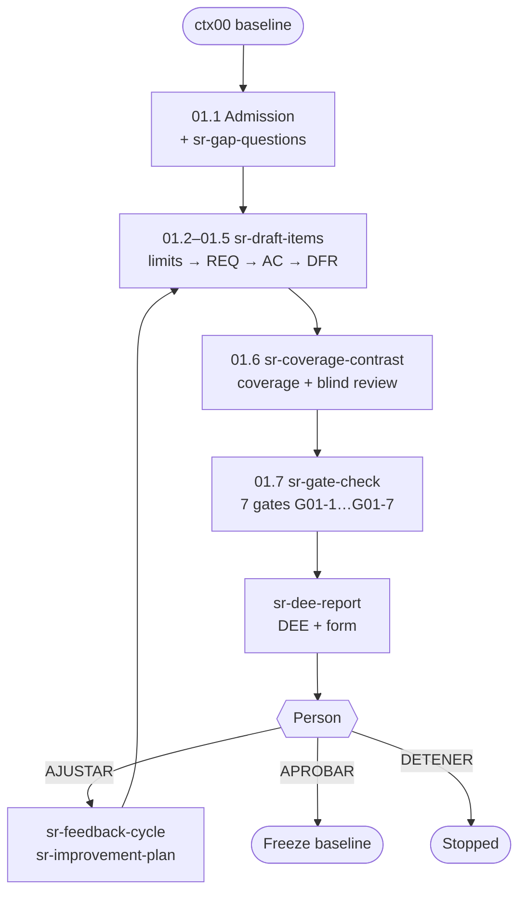
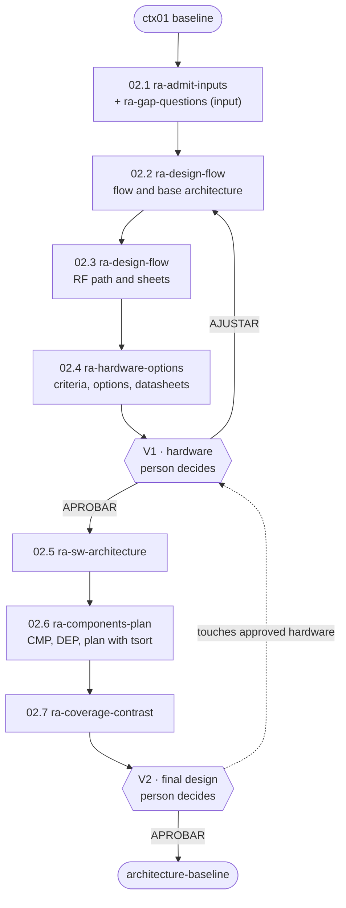
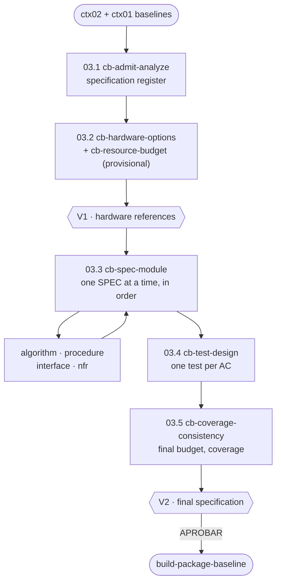

# Process for Generating the Build Package — Flow and Philosophy

> **What this document is for.** To explain the complete process that leads from an input document to the *Build Package*, with its philosophy, the overall flow and the flow of each stage. It is an explanation to understand and review the methodology; it is **not** the operational source.
>
> **Operational source.** What the agent executes is in `AGENTS.md` (entry point), `pipeline-layout/SKILL.md` (paths and hashes) and the `SKILL.md` of each stage. If this document disagrees with them, they prevail.
>
> **To use the methodology** (how to run it, where results end up, how to respond at each validation) see [`GUIA-DE-USO.md`](GUIA-DE-USO.md).
>
> **Version:** 4.0 · November 11, 2026.
>
> **What changes with respect to version 3.0.** Version 3.0 described a code engine with a common Stage Delivery Document, an `adjust-stage` skill and token and time logs. The current design is different: **the agent executes each stage by following skills** (`dp-*`, `sr-*`, `ra-*`, `cb-*`), mechanical checks are done with shell commands (`sha256sum`, `jq`, `grep`, `tsort`) and **no script is written or kept**. Results live in `results/ctxNN/`. Human validation is different in each stage (see §5). `adjust-stage`, the token logs and the shared rules engine no longer exist.

---

## 1. The result we are after

The **Build Package** is the system's construction manual: a complete, traceable specification approved by a person, with which a developer implements without having to decide anything about design.

> Every requirement ends up turned into a test that checks it; every design decision ends up written down, with its reason; and not a single number or procedure is left to the discretion of whoever builds.

Final product: `results/ctx03/build-package-baseline.json` (plus `.sha256` and `.md`) and `results/ctx03/final-spec.md`.

---

## 2. Philosophy

1. **The person decides.** The agent extracts, drafts, checks and asks. Scope, priorities, hardware and every approval (`APROBAR`, `AJUSTAR`, `DETENER`, `CERRAR_FORZADO`) are human decisions. A model never approves its own output and silence is never approval.
2. **Nothing is invented.** A value is `declarado` (declared) only if it is literally in a quote from the source, in a datasheet or in a human answer. Otherwise it is `derivado` (derived, with the operation written down) or `propuesto` (proposed, visibly). Where the material does not suffice, a question is asked.
3. **The mechanical is checked, not opined on.** Hashes, quotes, coverage, dependency order and units are verified with shell commands. What requires judgment is declared as such and reviewed with an independent context (subagent) or, if that is not possible, recorded as less reliable.
4. **What came before is read-only.** Each stage writes only to its own `results/ctxNN/` folder. A change that affects an already frozen stage is not an edit: it is an **escalation** (R0 scope, R1 requirements, R2 design) that the person decides.
5. **Nothing is lost silently.** Every received element has a recorded disposition (adopted, discarded with code, deferred, escalated). Seeded requirements are never deleted.
6. **Minimum viable product.** Every component or element cites the requirement that justifies it; anything "desirable" goes to `beyond-MVP`.
7. **Hash chain.** Each stage freezes a JSON *baseline* with its `.sha256`; the next one refuses to start if the hash does not verify.
8. **Isolated context per stage.** Each stage runs in a new session or with a clean context. The only thing that travels between stages is the files in `results/`, and each stage ends with a `CONTEXT-ctxNN.md` note that the next one reads first.
9. **Artifacts in English**, conversation in the person's language.

---

## 3. The overall flow

```mermaid
flowchart LR
    IN(["inputs/<br/>input document"]) --> E0["<b>ctx00</b><br/>Define the problem<br/>define-problem"]
    E0 --> H0{{"Human validation<br/>APROBAR"}}
    H0 --> E1["<b>ctx01</b><br/>Specify requirements<br/>specify-requirements"]
    E1 --> H1{{"Gate 1<br/>APROBAR / AJUSTAR / DETENER"}}
    H1 --> E2["<b>ctx02</b><br/>Resolve architecture<br/>resolve-architecture-v2"]
    E2 --> H2{{"V1 hardware<br/>V2 final design"}}
    H2 --> E3["<b>ctx03</b><br/>Compile the Build Package<br/>compile-build-package-v2"]
    E3 --> H3{{"V1 hardware references<br/>V2 final specification"}}
    H3 --> BP(["<b>Build Package</b>"])
    E3 -. "R2 / R1 / R0" .-> E2
    E2 -. "R1 / R0" .-> E1
    E1 -. "R0" .-> E0
```



| Stage | Input | Question it answers | Frozen output | Human stops |
|---|---|---|---|---|
| **ctx00** | document in `inputs/` | What problem, for whom, how far? | `problem-baseline.json` + `problem-definition.md` | 1 final review (up to 3 rounds) |
| **ctx01** | ctx00 baseline | What must it do, with what limits, how is it checked? | `requirements-baseline.json` (REQ, LIM, AC, DFR) | DEE per round (up to 6 outputs) |
| **ctx02** | ctx01 baseline | How is it solved and with what reference hardware? | `architecture-baseline.json` + `final-design.md` | V1 (hardware) and V2 (final design) |
| **ctx03** | ctx02 and ctx01 baselines | What does the developer receive so as to decide nothing? | `build-package-baseline.json` + `final-spec.md` | V1 (hardware references) and V2 (specification) |

**Structure of each stage.** All have a `SKILL.md` that is their **single entry point** and that orchestrates; a set of sub-skills with their own prefix that are loaded **one by one** (`dp-`, `sr-`, `ra-`, `cb-`); a `references/` folder with schemas, templates and registers; and, in ctx01–ctx03, an `evals/` folder that **no skill reads**.

**Repository structure and results:**

```
AGENTS.md  GUIA-DE-USO.md
inputs/                 input document(s)
pipeline-layout/        paths, hash rules, guardrails.md
define-problem/  specify-requirements/  resolve-architecture-v2/  compile-build-package-v2/
results/ctx00 … ctx03/  everything the methodology produces
```

**Common mechanisms (ctx01–ctx03):**

- **Mechanical admission:** before starting, `sha256sum -c` of the previous baseline and checks with `jq`. If it fails, the stage does not start: a version mismatch is repeated against the current baseline; a content defect is an R0/R1 return.
- **Open questions:** the agent asks only what passes three anti-bias tests, capped at 8 new questions per run. Each question is answered with content or with `CERRAR_FORZADO`.
- **Gates:** evidence tables (each gate with its ID, what was checked and the result). A `FAIL` does not prevent showing the document, but it **blocks `APROBAR`**. A rule is never relaxed to make something pass.
- **Blind review:** coverage in both directions plus a review by a subagent that does not see the draft.
- **Traceability:** `state.json` and `events.jsonl` record the state, so that a new session can resume.

---

## 4. Flow of each stage

### 4.1 ctx00 · Define the problem (`define-problem`)

**Goal.** Agree on the stable problem before talking about requirements or solutions. No solution is named: if the material brings one, it is set aside as `SOL-nn`.



- **Cross-cutting checks:** `dp-verify-citations` (literal quote against the material or the local copy of the source), `dp-verify-consistency` (classification, magnitudes, contradictions) and `dp-gap-search` (gap search).
- **Human validation: just one, at the end.** There is no review between sub-stages; open questions accumulate and are presented together in the document.
- **Rounds:** up to 3 feedback rounds; the gap search is repeated at most 2 times (after rounds 1 and 2).
- **Approval:** only with the person's literal `APROBAR` and their name, and with zero open questions. If after round 3 it is not clean, the stage is left **not approved** and restarts with a corrected input.
- **Output:** `results/ctx00/` with `intake.md` (immutable), `sources/`, `problem-definition.md` (11 sections), `problem-baseline.json`, `problem-baseline.sha256`, `CONTEXT-ctx00.md`.

### 4.2 ctx01 · Specify requirements (`specify-requirements`)

**Goal.** Turn the frozen problem into measurable requirements and acceptance criteria. Only **what** is said, never **how**: no algorithms, architecture or component contracts.



- **Elements:** `REQ` (requirements), `LIM` (limits with value, unit, direction and source), `AC` (acceptance criteria), `DFR` (controlled deferrals) and **seeded** requirements from `pipeline-layout/guardrails.md`.
- **Key rules:** everything transferred from ctx00 ends up adopted or discarded with a code; every objective and every scope element has at least one requirement or an approved exclusion; a value that is not in the literal quote is never `declarado`.
- **Human validation:** the agent issues a **DEE** (a six-section document: summary, content, what the agent decided, what remains open, gate results and pending decision) and a response form. The person responds with `APROBAR`, `AJUSTAR` or `DETENER`.
- **Rounds:** up to **6 outputs** (O1–O6). New questions only in O1 and O2; in O3 those still open are **forced closed**; from O4 on, only improvement themes. After O6 only `APROBAR` or `DETENER` is possible.
- **Approval:** clean gates and human signature. With any `DFR` open, the only possible approval is `APROBAR_CON_APLAZAMIENTO`.
- **Output:** `results/ctx01/` with `record.json`, `state.json`, `events.jsonl`, `rounds/O<n>/`, `requirements-baseline.json/.sha256/.md`, `CONTEXT-ctx01.md`.

### 4.3 ctx02 · Resolve the architecture (`resolve-architecture-v2`)

**Goal.** Design the architecture and choose **hardware references** (only the SDR and the compute board); everything else gets a characteristics sheet. Procedures and parameters are not specified (that is ctx03) and requirements are not invented (that is ctx01).



- **Phase A (up to V1):** flow, minimal architecture, RF path and hardware comparison. The **criteria are written and saved before comparing** alternatives; the comparison applies an eliminatory filter with evidence per cell, an ordinal ranking and a robustness test.
- **V1 (hardware):** the hardware is approved, and approved items are **locked** (`locked_v1`).
- **Phase B (up to V2):** software architecture, components (`CMP`), dependencies (`DEP`) and plan (must match the `tsort` order).
- **Gates:** G02-1 to G02-8 (input integrity, prior criteria, eliminatory filter, scope/MVP, boundary with ctx03, questions, bidirectional coverage and DFR closure, acyclic graph).
- **Rounds per validation:** R1 and R2 allow new questions; R3 only answers and themes; **R4 only `APROBAR` or `DETENER`**. Up to 3 adjustments per validation (V1 and V2 separately).
- **Escalations:** `escalate:V1` (a change in V2 touches already approved hardware; consumes a V1 round), `escalate:R1` or `escalate:R0` (state `returned_upstream`).
- **Output:** `results/ctx02/` with `state.json`, `events.jsonl`, `questions.json`, `items.json`, `substages/`, `validations/V1|V2/R<n>/`, `architecture-baseline.json/.sha256/.md`, `final-design.md`, `CONTEXT-ctx02.md`.

### 4.4 ctx03 · Compile the Build Package (`compile-build-package-v2`)

**Goal.** Specify how each requirement is met in practice, without changing the architecture or the requirements. It closes what ctx02 left open (`TBD-Ctx03`, deferrals, unverified points such as the board's maximum temperature or its compute load).



- **Loop discipline (03.3):** one module is finished, self-checked and registered before starting the next; the register order is the only order; a module is never skipped. If a value is missing that only a person can give, the module is completed with a `provisional` value and a candidate question.
- **Self-sufficient package:** requirement values and text are copied, not referenced; no executable code, no measurement results, no `TBD`.
- **Consistency with the hardware:** every value that uses compute, memory, storage, throughput, power, RF level or time is checked against a cited capacity, with margin.
- **Tests:** one test per acceptance criterion, with a threshold identical to the criterion's, three cases and a failure condition.
- **Gates:** G03-1 to G03-11 (includes the **consumer test**: a blind implementer who reads only the package must not need any design decision).
- **Web:** only in 03.2, for datasheets, and queries carry only component names and specifications, never project data.
- **Rounds and escalations:** same as ctx02, with returns `escalate:V1`, `R2`, `R1`, `R0`.
- **Output:** `results/ctx03/` with `state.json`, `STATUS.md`, `events.jsonl`, `questions.json`, `items.json`, `spec-register.json`, `specs/SPEC-nn.md`, `validations/`, `build-package-baseline.json/.sha256/.md`, `final-spec.md`, `CONTEXT-ctx03.md`.

---

## 5. Human validation: comparative summary

| | ctx00 | ctx01 | ctx02 | ctx03 |
|---|---|---|---|---|
| Number of stops | 1 | 1 per output (up to 6) | 2 (V1, V2) | 2 (V1, V2) |
| Document that is read | `problem-definition.md` | `rounds/O<n>/dee.md` | `validations/V<k>/R<n>/hardware-proposal.md` or `final-design.md` | `validations/V<k>/R<n>/hardware-proposal.md` or `final-spec.md` |
| Where it is answered | in the chat (`APROBAR` + name and answers to the questions) | `rounds/O<n>/response-form.md` | `validations/V<k>/R<n>/feedback.md` | `validations/V<k>/R<n>/feedback.md` |
| Decisions | `APROBAR` / adjustments / stop | `APROBAR` · `AJUSTAR` · `DETENER` | same | same |
| Forced closure | question closed by the person as "forced" | automatic in O3 | `CERRAR_FORZADO: <Q-id>` | `CERRAR_FORZADO: <Q-id>` |
| Cap | 3 rounds | 6 outputs | 3 adjustments per validation | 3 adjustments per validation |
| What blocks `APROBAR` | open questions | gate in `FAIL` | open question of that gate or gate in `FAIL` | same |
| Result if not approved | `not_approved` | `DETENER` | `stopped` / `blocked` / `returned_upstream` | same |

**Invariants of every validation:** the agent stops and waits; the person approves with their explicit decision; no question is closed without an answer or `CERRAR_FORZADO` (except ctx01's automatic closure in O3); every answer and every theme receives a recorded disposition.

---

## 6. How quality is protected

- **Visible provenance** (`declarado` / `derivado` / `propuesto`) on every value and decision.
- **Literal quotes** verified against the input material or the local copy of the source.
- **Coverage in both directions** (objective → requirement → component → specification → test, and back).
- **Blind review** by an independent context in ctx01–ctx03.
- **Chained hashes**, verified when admitting each stage.
- **Green gates are necessary, not sufficient:** the person may respond `AJUSTAR` with everything green; looking at the content and not being convinced is already a finding.

**Known limits.** Without subagents, independent reviews run in the same context and are recorded as less reliable. Whether the human reviewer provides truly independent judgment remains an open question of the methodology.
